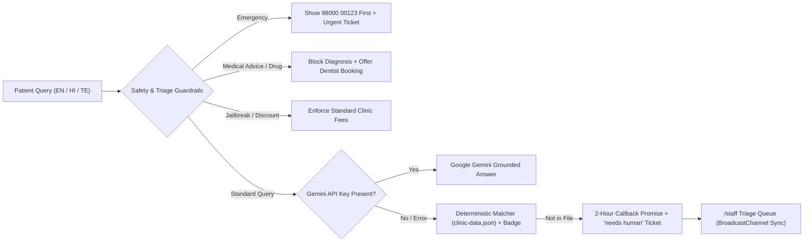
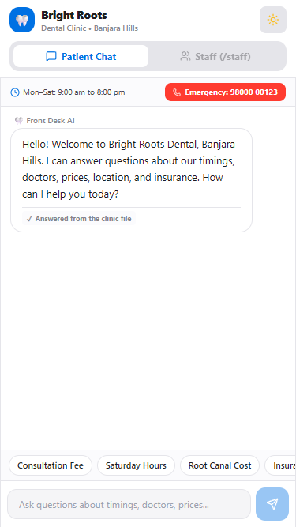
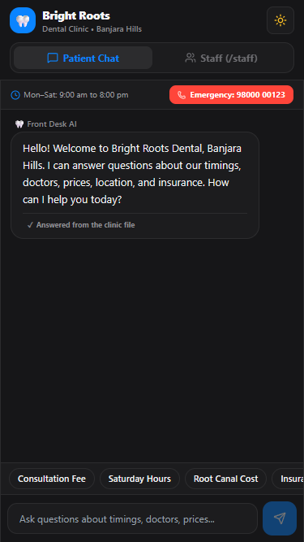
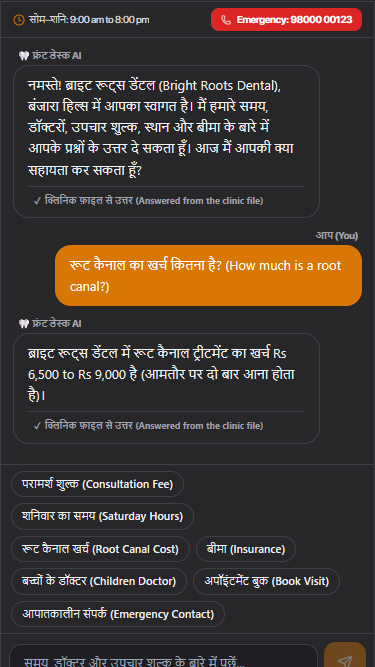
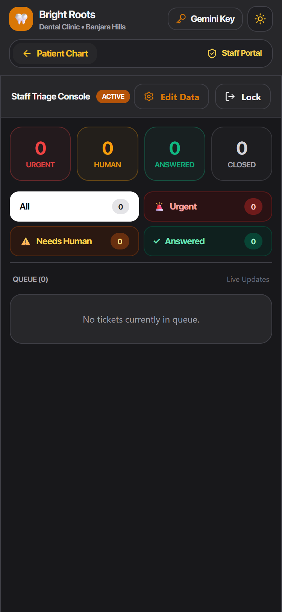

# FrontDesk AI — Multilingual Dental Clinic Receptionist & Triage Portal

[](https://frontdesk-ai-dental.vercel.app)
[](https://react.dev/)
[](https://www.typescriptlang.org/)
[](./LICENSE)

**FrontDesk AI** is a mobile-first (`375px`) AI patient receptionist and real-time staff triage console built for a sample dental clinic (*Bright Roots Dental, Banjara Hills, Hyderabad*). It combines **Google Gemini** conversational answers with a **zero-key deterministic fallback engine**, clinical safety guardrails, trilingual support (**English, Hindi, Telugu**), and instant cross-tab staff-to-patient messaging.

> **Note:** The clinic profile, doctor names, fees, and seeded queue tickets in `clinic-data.json` are **sample demonstration data**.

---

## Live Demo

* **Patient Chat:** [https://frontdesk-ai-dental.vercel.app](https://frontdesk-ai-dental.vercel.app)
* **Staff Triage Console:** [https://frontdesk-ai-dental.vercel.app/staff](https://frontdesk-ai-dental.vercel.app/staff)
* **URL Auto-Query Test:** [https://frontdesk-ai-dental.vercel.app/?q=What+time+do+you+open+on+Saturday%3F](https://frontdesk-ai-dental.vercel.app/?q=What+time+do+you+open+on+Saturday%3F)
* **Zero-Key Fallback Mode:** Add `?nokey=true` to test deterministic offline grounding.

---

## Architecture & Core Capabilities



* **Dual-Run AI + Deterministic Fallback (`src/services/aiService.ts`, `fallbackMatcher.ts`):** Uses Google Gemini when an API key is provided, and seamlessly falls back to a deterministic local matcher strictly grounded in `clinic-data.json`—displaying an `"Answered from the clinic file"` transparency badge so prices, doctors, and timings are never hallucinated.
* **Clinical Safety & Policy Guardrails:**
  * **Medical Advice Firewall:** Refuses drug names/diagnoses and insists on an in-person dentist exam.
  * **Emergency Protocol:** Detects acute symptoms (severe swelling, bleeding, breathing issues), prioritizes the emergency phone line, and opens an `urgent` ticket.
  * **Prompt-Injection Defense:** Rejects discount overrides and policy-bypass attempts.
* **Trilingual Support (English · हिन्दी · తెలుగు):** Native-script and transliterated intent detection plus localized UI headers, greetings, and quick-reply chips.
* **Zero-Refresh Staff Triage Portal (`/staff`):** Priority-sorted queue (`urgent` → `needs human` → `answered` / `closed`), live ticket ageing timers, instant bidirectional staff-to-patient replies via `BroadcastChannel` + `localStorage` polling, and a live clinic data editor that immediately updates subsequent bot answers.

---

## Verified Audit Results

* **Comprehensive Requirements Audit:** **30 / 30 (100%)** passed across Local & Live Vercel (`tests/test-audit-all-requirements.cjs`).
* **End-to-End Battery:** **23 / 23** core tests passed (`tests/test-e2e.cjs`).
* **375px Mobile Viewport Check:** **11 / 11** views passed with `0px` horizontal overflow (`tests/check-375px-scroll.cjs`).

---

## Screenshots

| Patient Chat (`375px` Light) | Patient Chat (`375px` Dark) | Hindi Chat (`375px`) | Staff Triage Queue (`375px`) |
| :---: | :---: | :---: | :---: |
|  |  |  |  |

---

## Local Setup

1. Install dependencies:
   ```bash
   npm install
   ```
2. *(Optional)* Copy `.env.example` to `.env` and add your Gemini key to test LLM mode alongside the zero-key fallback:
   ```bash
   cp .env.example .env
   ```
3. Start the development server:
   ```bash
   npm run dev
   ```

---

## Project Structure

```text
frontdesk-ai/
├── src/
│   ├── components/
│   │   ├── PatientChat.tsx     # 375px patient chat, quick chips, ?q= handler
│   │   └── StaffDashboard.tsx  # /staff priority queue, live editor, reply sync
│   ├── services/
│   │   ├── aiService.ts        # Gemini API integration + zero-key failover
│   │   ├── fallbackMatcher.ts  # Grounded matcher, safety firewall, EN/HI/TE detection
│   │   ├── clinicData.ts       # Live editable clinic state store
│   │   ├── ticketStore.ts      # BroadcastChannel + localStorage cross-tab sync
│   │   └── translations.ts     # English, Hindi, and Telugu UI localization
│   ├── App.tsx
│   └── types.ts
├── clinic-data.json            # Sample clinic knowledge base
├── tests/                      # Puppeteer audit, E2E, sorting, and 375px tests
├── docs/screenshots/           # Curated mobile & desktop screenshots
└── IMPLEMENTATION-PLAN.md
```

---

## License

MIT License — Copyright (c) 2026 Karthik Karka. See [LICENSE](./LICENSE).
